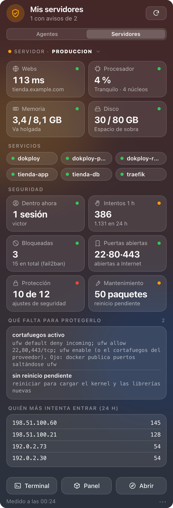
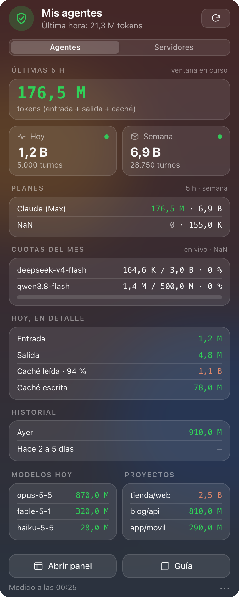

# infobar

Tus agentes de IA y tus servidores, en la barra de menús del Mac.

Al pulsar el icono se abre un desplegable con dos pestañas:

- **Agentes**: consumo de tokens de Claude Code, Codex, OpenCode y pi (ventana de 5 h, semana, hoy,
  planes, cuotas mensuales de NaN en vivo, modelos y proyectos).
- **Servidores**: estado de cada VPS, que eliges en un selector. Incluye webs, CPU, memoria, disco,
  servicios de Dokploy o Easypanel, intentos de entrar, fail2ban, puertos abiertos a Internet,
  actualizaciones y una revisión de **protección** que dice qué falta y cómo arreglarlo.

| Servidores | Agentes |
|---|---|
|  |  |

*(Capturas con datos de ejemplo.)*

> **Basado en [codeia-cost-guard](https://github.com/yosnap/codeia-cost-guard)** de
> [Codeia](https://codeia.dev) (Paulo), con la cuota en vivo de NaN de
> [Daniel](https://github.com/dmaurelc/codeia-cost-guard/tree/feat/nan-live-usage). Licencia MIT: se
> conserva el aviso de copyright original en `LICENSE`.

## Instalación (macOS)

```bash
git clone <este repo> infobar && cd infobar
cp config.example.json config.json     # tu configuración (no se sube al repo)
./install.sh                           # copia a ~/.cost-guard y arranca sola al iniciar sesión
```

Necesita Python 3.9+ (el del sistema vale) y Chrome, Chromium, Brave o Edge: el desplegable se pinta
con el navegador en modo invisible. `install.sh` crea su propio entorno con Pillow y PyObjC.

Para actualizar tras un `git pull`, vuelve a ejecutar `./install.sh`. No pisa tu configuración.

En Linux y Windows no hay barra de menús, pero el medidor sí funciona: `python3 analizar_gasto.py`
(informe en la terminal) y `python3 panel.py` (panel HTML).

## Configuración

Todo vive en `~/.cost-guard/config.json` una vez instalado. Parte de
[`config.example.json`](config.example.json).

- **Planes de IA** (`proveedores`, `aliases`): qué modelos son de qué suscripción y sus límites.
  `python3 costbar.py --proveedores` te propone la lista a partir de tus logs.
- **Servidores** (`servidores`): ver [docs/guia-servidores.md](docs/guia-servidores.md).
- **Claves** (NaN y otras): **nunca** en `config.json`. Van al Llavero de macOS:
  ```bash
  python3 costbar.py --clave nan       # la pide sin mostrarla
  ```

Claude Max y ChatGPT Plus son suscripciones sin API pública de consumo: se miden con los logs locales
de Claude Code y Codex. NaN sí tiene API (`/v1/usage`). Con `"uso_api": "nan"` en su plan, la cuota
del mes sale en vivo, e incluye lo que consumas desde otras máquinas.

## Servidores

infobar entra en cada servidor por SSH con un **usuario de solo lectura** (`infobar`), cuya clave
solo puede ejecutar un script de lectura instalado en el servidor. Para dar de alta uno:

```bash
infobar/remoto/alta-servidor.sh victor@203.0.113.10
```

La guía completa (permisos, puertos, problemas frecuentes y qué significa cada aviso) está en
[docs/guia-servidores.md](docs/guia-servidores.md). Los comandos del día a día están en
[docs/chuleta.md](docs/chuleta.md).

## Seguridad

- En los servidores solo se **lee**. La clave de infobar lleva `restrict,command=` y no da una
  shell. `sudo` solo se permite para un programa fijo, sin argumentos.
- Las claves van en el **Llavero**, y `config.json` está fuera del repo. El panel local
  (`127.0.0.1:47391`) rechaza peticiones de otras webs (`Host`/`Origin`) y nunca devuelve claves.
- Los datos de los servidores se escapan antes de pintarse, y la página del desplegable no puede
  ejecutar scripts ni conectarse a nada (CSP).
- Si la clave de un servidor es rechazada, infobar espera 30 min antes de reintentar, para que
  fail2ban no bloquee tu IP.
- No usa las APIs de Dokploy ni de Easypanel: sus claves dan acceso a todos los secretos de
  producción.

## Compartir el repo

En el repo no hay nada tuyo:
- `config.json`, `state.json`, `logs/` y el entorno de Python local están en `.gitignore`.
- Las claves viven en tu Llavero, y la de SSH en `~/.ssh/infobar_ed25519`.
- Las capturas usan datos de ejemplo.

Quien lo clone crea su `config.json` desde el ejemplo y da de alta sus propios servidores.

Los planes de trabajo (`plans/`) y tus notas (`docs/chuleta-personal.md`) se quedan en tu disco:
están en `.gitignore`.

## Cómo cuenta los tokens

No te arruina el *effort* del modelo: te arruina **cuántas veces le mandas el contexto**. Alrededor
del 75 % del gasto típico es caché leída, es decir, el mismo contexto reenviado turno tras turno.
Por encima de **272.000 tokens**, toda la petición se factura a 2× la entrada y 1,5× la salida.
Más detalle en [GUIA.md](GUIA.md).

- **Claude Code**: una línea por respuesta con `message.usage`; la entrada y la caché ya vienen
  separadas. Los forks copian los turnos de sus padres, así que se cuentan una sola vez.
- **Codex**: cada turno se escribe dos veces (mismo segundo) y además va un total **acumulado**. Se
  usa el uso del turno, y `cached_input_tokens` va **dentro** de `input_tokens`.
- **OpenCode** (SQLite, mensaje a mensaje), **pi** (JSONL) y **Hermes**.

Los dólares son un **equivalente API**, no tu factura. Las tarifas están en `TARIFAS`, dentro de
`infobar/planes_y_tarifas.py`.

Las **reglas de ahorro** para tus agentes (contexto por debajo de 200K, parches en vez de reescribir
ficheros, fan-out máximo 3…) se instalan con `./install.sh --reglas` o con
`python3 instalar_reglas_globales.py`. El texto exacto está en [AGENTS-snippet.md](AGENTS-snippet.md).

## Estructura

| Fichero | Qué es |
|---|---|
| `barra.py` | La app de la barra: icono, desplegable, menús y clics |
| `costbar.py` | Entrada de línea de comandos (`--print`, `--clave`, `--proveedores`) y fachada del motor |
| `infobar/` | El motor: lectores de logs, agregación, NaN, servidores, desplegable, panel local |
| `infobar/remoto/` | Scripts para los servidores: alta, recogida, cerrar un puerto de docker |
| `panel.py`, `panel_assets/` | Panel web (`127.0.0.1:47391`) |
| `popover.py` | Vista previa del desplegable en HTML, para depurar el diseño |
| `tests/` | `python3 -m unittest discover tests` (sin dependencias) |

## Licencia

MIT. Ver `LICENSE`.
